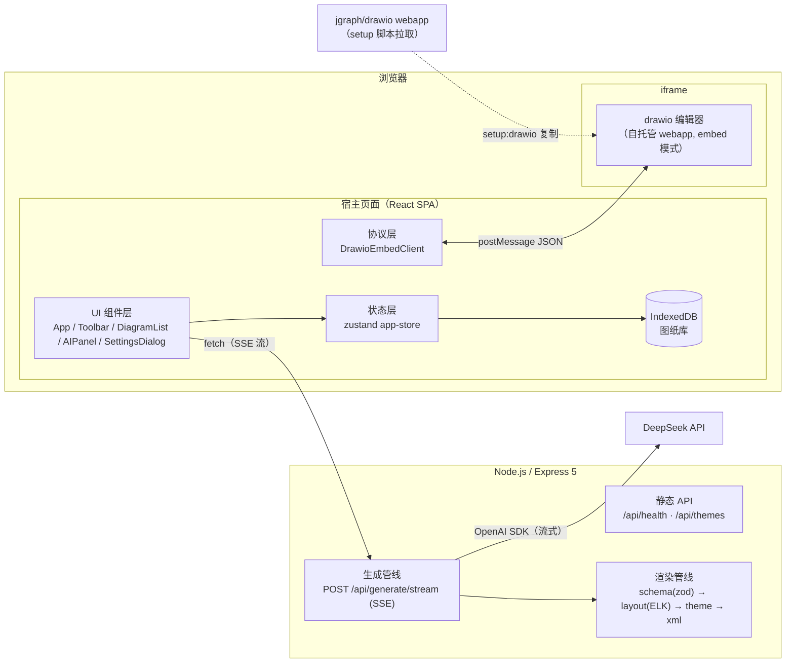
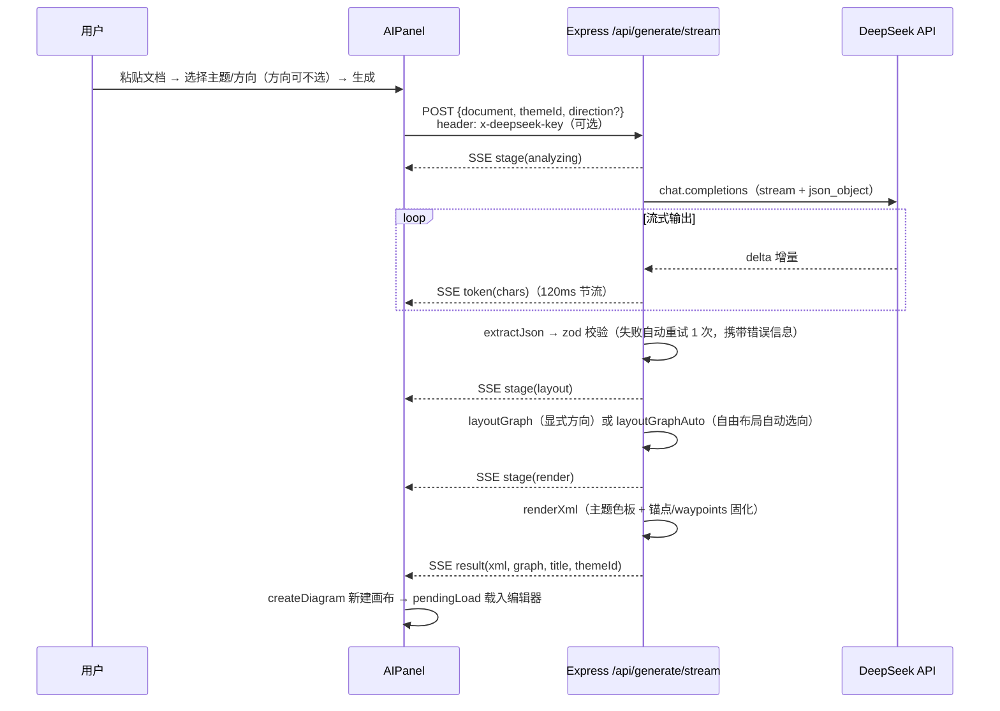
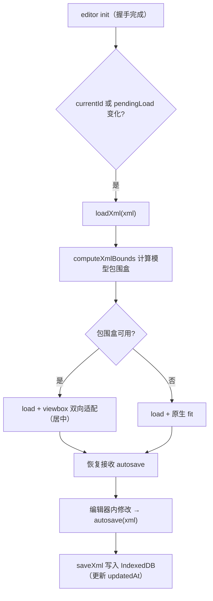

# drawAI 架构设计文档

> 基于 drawio 的 AI 架构图画布：输入一段技术文档，自动生成配色统一、分层清晰的架构图。

## 1. 项目概述

### 1.1 定位

drawAI 面向"把技术文档快速变成架构图"的场景：用户粘贴技术方案 / 设计文档，AI 提炼出结构化架构数据，服务端完成自动布局与主题渲染，产出一张可直接编辑、导出的 drawio 图。

### 1.2 设计目标与原则

| 原则 | 说明 |
|---|---|
| AI 只输出结构化 JSON | 节点 / 关系 / 分组由模型输出；配色、形状、坐标 100% 由服务端控制，规避 AI 直出 XML 的解析错误与配色失控 |
| 复用 drawio 原生能力 | 自托管官方 drawio webapp，经 embed postMessage 协议集成，保留形状库、格式面板、导入导出等全部原生功能 |
| 布局与渲染分离 | 布局（elkjs）与渲染（主题 → mxGraphModel XML）为独立模块，可分别替换与测试 |
| 本地优先 | 图纸存储于浏览器 IndexedDB，无需账号与后端持久化，刷新自动恢复 |
| 开箱可用 | 未配置 API Key 时自动进入演示模式（内置示例数据），完整流程可体验 |

## 2. 总体架构

### 2.1 系统上下文



### 2.2 运行时形态

| 形态 | 入口 | 说明 |
|---|---|---|
| 开发 | `npm run dev` | Vite(5173) 托管前端并将 `/api` 代理到 Express(3000)；`/drawio` 由 Vite 直接提供静态资源 |
| 生产 | `npm start` | 单进程 Express(3000)：托管 `client/dist`（SPA + drawio 静态资源）+ 全部 API |

生产模式下 Express 的静态托管顺序（`server/src/index.ts`）：

1. `/drawio` → `client/dist/drawio`（`maxAge: 7d, immutable`，强缓存）
2. `client/dist` 其余静态资源（`maxAge: 1h`）
3. SPA 兜底：非 `/api` 的 GET 请求回退 `index.html`
4. `/api` 未匹配路径统一 404（避免落入 SPA fallback）

## 3. 技术选型

| 层 | 技术 | 版本 | 用途 |
|---|---|---|---|
| 画布引擎 | 自托管 drawio webapp | v31.4.6 | 图形编辑，经官方 embed postMessage 协议集成 |
| 前端框架 | React + TypeScript + Vite | React 19 / TS 7 / Vite 8 | SPA 构建 |
| 样式 | TailwindCSS | 4 | 原子化样式 |
| 前端状态 | Zustand | 5 | 全局状态（图纸列表 / 当前图纸 / 生成状态） |
| 本地存储 | idb（IndexedDB 封装） | 8 | 图纸库持久化 |
| 后端框架 | Express + tsx | Express 5 | API 与 SSE 流；tsx 直跑 TS（开发） |
| LLM SDK | openai（OpenAI 兼容） | 7 | 调用 DeepSeek 流式 chat completions |
| 结构化校验 | zod | 4 | 模型输出校验 + 类型推导 |
| 布局引擎 | elkjs（ELK layered） | 0.12 | 分层自动布局 + 正交边路由 |
| 测试 | vitest | 5 | 服务端渲染 / 布局 / 校验单测 |

## 4. 模块设计

### 4.1 仓库结构（npm workspaces）

```
drawAI/
├─ scripts/setup-drawio.mjs     # 拉取固定 tag 的 drawio webapp（sparse checkout）
├─ client/                      # 前端工作区
└─ server/                      # 后端工作区
```

根 `package.json` 声明 `workspaces: ["client", "server"]`，依赖由根统一解析，脚本经 `-w` 分发：

| 脚本 | 动作 |
|---|---|
| `npm run setup:drawio` | 稀疏克隆 jgraph/drawio，把 `src/main/webapp` 复制到 `client/public/drawio`（幂等，`--force` 重拉；tag 顺序：`DRAWIO_TAG` > latest release > `dev`） |
| `npm run dev` | concurrently 并行启动 server（tsx watch）与 client（vite） |
| `npm run build` | 先 client（`tsc --noEmit && vite build`）后 server（`tsc`） |
| `npm start` | `node server/dist/index.js`，生产托管 |
| `npm test` | 服务端 vitest |

### 4.2 前端（client/src）

```
src/
├─ App.tsx                    # 主布局：DiagramList | Toolbar + DrawioCanvas | AIPanel
├─ components/
│  ├─ DrawioCanvas.tsx        # iframe 生命周期、协议握手、图纸加载、autosave 持久化
│  ├─ Toolbar.tsx             # 新建 / 导入 / 撤销重做 / 缩放 / 适应 / 保存 / 导出
│  ├─ DiagramList.tsx         # 多画布列表（缩略图、重命名、删除、时间显示）
│  ├─ AIPanel.tsx             # 文档输入、主题与方向选择、SSE 进度展示
│  └─ SettingsDialog.tsx      # API Key / 模型名（localStorage）
├─ lib/
│  ├─ drawio-protocol.ts      # drawio embed postMessage 协议客户端
│  ├─ xml-bounds.ts           # 解析 XML 沿父子链累加，计算模型包围盒
│  ├─ storage.ts              # IndexedDB 图纸库 + 空白图 XML 生成
│  ├─ api.ts                  # /api 客户端（主题列表 + SSE 生成流解析）
│  ├─ settings.ts             # AI 设置读写（localStorage）
│  └─ download.ts             # data URI / 文本下载
├─ stores/app-store.ts        # zustand 全局状态
└─ types.ts                   # 共享类型（DiagramRecord / ThemeInfo / SSE 类型）
```

关键职责：

- **DrawioEmbedClient**（`lib/drawio-protocol.ts`）：封装 iframe 挂载、消息队列与超时、握手、`load / merge / export / fit / viewbox / invokeAction / spinner` 等方法。协议无请求 id，采用**串行请求队列**按事件类型顺序匹配响应（load 30s / export 60s / 其余 15s 超时）。`mount` 时以 `embed=1&proto=json&configure=1&libraries=1&noSaveBtn=1&noExitBtn=1` 等参数加载 `/drawio/index.html`。
- **DrawioCanvas**：编辑器只初始化一次（`onReady` 后置 `canvasReady`）；`currentId` 变化或 `pendingLoad`（AI 生成 / 导入）变化时调用统一入口 `loadXml`。用 `acceptingAutosaveRef` 门控：加载期间丢弃 autosave，避免旧图内容写入新图；加载完成后恢复接收，autosave 的 XML 写入 `loadedIdRef` 指向的图纸。
- **app-store**：图纸列表（按 `updatedAt` 倒序）、`currentId`、`canvasReady`、`generating`、`pendingLoad`（带 nonce 保证重复请求也触发加载）。所有写操作先落 IndexedDB 再更新内存态。

### 4.3 后端（server/src）

```
src/
├─ index.ts              # Express 入口：API 路由 + 生产静态托管 + .env 加载
├─ routes/generate.ts    # POST /api/generate/stream：SSE 生成管线
├─ llm/deepseek.ts       # DeepSeek 客户端：流式生成 + 校验 + 自动重试
├─ prompt/index.ts       # SYSTEM_PROMPT + few-shot 示例 + MOCK_GRAPH 演示数据
└─ render/
   ├─ schema.ts          # GraphData 的 zod 校验与 sanitize 清洗
   ├─ layout.ts          # ELK layered 布局 + 正交边路由提取
   ├─ theme.ts           # 5 套主题色板（单一事实来源）
   └─ xml.ts             # 渲染 mxGraphModel XML（样式 / 锚点 / waypoints）
```

关键职责：

- **index.ts**：启动时依序尝试加载根目录与 server 目录的 `.env`（兼容 tsx 直跑 `src/` 与编译后跑 `dist/`）；禁用 `x-powered-by`；`express.json({ limit: '1mb' })`；提供 `/api/health`（返回模型名与是否已配置服务端 Key）与 `/api/themes`；生产模式下按 2.2 节顺序托管静态资源。
- **routes/generate.ts**：见第 5 节生成管线；SSE 响应头含 `Cache-Control: no-cache, no-transform`、`X-Accel-Buffering: no`（防反向代理缓冲）；15s 心跳注释帧 `: ping` 保活；客户端断开经 `res.on('close')` + `writableEnded` 判别，中断时 `AbortController` 中止上游 LLM 请求。
- **llm/deepseek.ts**：`resolveLlmConfig` 的优先级为**请求头 `x-deepseek-key`（前端设置面板）> 服务端 `.env` > 默认值**；以 `temperature: 0.2`、`response_format: json_object`、`stream: true` 调用；`extractJson` 容忍 markdown 代码块与多余文字；zod 校验失败时把错误信息与上次输出追加为消息，**自动重试 1 次**（`MAX_ATTEMPTS = 2`），仍失败抛 `GenerationError`（保留原始输出）。
- **prompt/index.ts**：SYSTEM_PROMPT 约定 JSON 结构、10 类节点语义类型、6–28 节点 / 2–5 分组、solid（同步调用）与 dashed（异步消息）等设计规则；附 2 组 few-shot（电商微服务、SaaS 云部署）教模型输出格式与分组策略；`MOCK_GRAPH` 为演示模式数据。
- **render/**：见第 5.2 节。

## 5. 核心流程

### 5.1 AI 生成管线（SSE）



SSE 消息类型：

| type | 载荷 | 用途 |
|---|---|---|
| `stage` | `stage, message` | 阶段推进：analyzing → generating → layout → render → done |
| `token` | `chars` | LLM 已输出字符数（120ms 节流，仅进度展示） |
| `result` | `xml, graph, title, themeId` | 最终产物（XML + 结构化数据） |
| `error` | `message` | 已映射为可读中文的错误信息 |

请求约束与演示模式：`document` 必填且 ≤ 24000 字符（超出返回 400）；`direction` 可选 `LR` / `TB` / `FREE`，默认 `FREE`（自由布局：分别按横向、纵向布局，自动选更贴合画布的一种）；`themeId` 非法时回退默认主题；无可用 API Key 或 `mock: true` 时跳过 LLM，使用内置 `MOCK_GRAPH` 并按阶段插入延时以演示完整进度。

### 5.2 服务端渲染管线（render/）

四段式管线，各段职责单一、可独立测试：

1. **schema.ts（校验与清洗）**
   - `graphDataSchema` 约束：nodes 1–40、edges ≤ 90、groups ≤ 12、id ≤ 64 字符、label ≤ 160 字符；节点 `type` 为 10 种枚举之一。
   - `sanitizeGraphData` 清洗：节点 id 去重；丢弃引用不存在节点与自环的边；分组引用过滤，节点只归属第一个声明的组，空组剔除。
2. **layout.ts（ELK 布局）**
   - 输入 GraphData + 方向（LR / TB / FREE），输出节点/分组坐标、边路由（起点锚点、折点、终点）、画布尺寸。
   - 分组以 ELK 层级节点表达（`elk.padding` 的 top 为标题栏预留 40px）；节点尺寸按标签文本估算（中文字符全宽、其余 0.62 倍，宽 110–300，高 46 / 圆柱类 58）。
   - 布局参数：`algorithm=layered`、`hierarchyHandling=INCLUDE_CHILDREN`、`edgeRouting=ORTHOGONAL`、层间距 76、节点间距 42、边-节点间距 24、画布四周留白 56。
   - 自由布局：ELK layered 必须指定方向，故 `FREE` 由 `layoutGraphAuto` 分别跑 LR/TB，按 1600×1000 基准视口计算缩放比 `max(w/1600, h/1000)`（折点略多小幅惩罚），取更贴合画布的一种，路由与显式选向完全一致。
   - 边路由提取：按 `edge.container`（LCA）把组内边坐标平移到画布绝对坐标；`simplifyPath` 去重合并共线冗余折点。
3. **theme.ts（主题色板）**
   - 5 套主题：深海蓝（默认）/ 石墨商务 / 森野绿 / 星夜紫 / 极简灰，每套定义背景、分组、连线与 10 类节点的 fill/stroke/text。
   - 该文件是配色的**单一事实来源**，经 `GET /api/themes` 透传给前端（前端 `types.ts` 保持同构）；`getTheme` 对未知 id 回退默认。
4. **xml.ts（XML 渲染）**
   - id 重映射：节点 `n1..`、分组 `g1..`、边 `e1..`，规避模型输出的非法字符；组内节点 `parent` 指向分组容器。
   - 形状按语义类型切换：gateway 六边形、database/storage 圆柱、queue 横向流程、external 云形，其余圆角矩形。
   - **连线固化**：把 ELK 路由的起止点换算为边框比例锚点（`exitX/exitY/entryX/entryY`，相对节点宽高，clamp 到 [0,1]），中间折点写为 `mxGeometry` 的 `Array as="points"`（waypoints）。这样 drawio 不再自行重路由，连线沿 ELK 的避障路径绕开图形块。
   - 页面尺寸不小于 A4 基准 1169×826；文本统一 XML 转义（含换行实体）。

### 5.3 画布加载与自动保存



- 加载期间 autosave 被门控丢弃，避免切换图纸时旧内容写入新图。
- 适应视口不用 drawio 原生 fit：其 `ignoreHeight` 仅按宽度适配，纵向长图会溢出被裁；宿主侧 `computeXmlBounds` 沿父子链累加坐标（含旋转 90°/270° 宽高互换）算出模型包围盒，走 `viewbox` action 双向适配。工具栏"适应画布"同样基于最新 XML 现算包围盒。

### 5.4 embed 协议交互（lib/drawio-protocol.ts）

| 方向 | 消息 | 说明 |
|---|---|---|
| 编辑器 → 宿主 | `configure` | 握手开始；宿主回 `{action:'configure', config}`（注入中文字体优先序，保证中文渲染） |
| 编辑器 → 宿主 | `init` | 编辑器就绪，`ready` Promise 完成 |
| 宿主 → 编辑器 | `load` | 加载 XML；`autosave:1` 开启修改推送；`exportProtocol:true` 让编辑器内导出交给宿主下载 |
| 编辑器 → 宿主 | `autosave` | 编辑器内任何修改后推送最新 XML |
| 宿主 → 编辑器 | `export` | 请求导出（xml / svg / xmlsvg / png / xmlpng…） |
| 编辑器 → 宿主 | `export` | 编辑器 UI 触发的导出（无待处理请求时按 UI 导出处理，由宿主下载） |
| 宿主 → 编辑器 | `viewbox` / `fit` | 视口适配 |
| 宿主 → 编辑器 | `invokeAction` | 调用内置动作（undo/redo/zoomIn/zoomOut），无响应 |

### 5.5 导入与导出

- **导入**（Toolbar）：`.drawio / .xml / .svg` 读文本，`.png`（内嵌 XML 的 drawio 导出文件）转 data URI；统一 `createDiagram({name, xml})` 新建画布，由 `currentId` 变化触发加载。
- **导出**：PNG(2x) / SVG / SVG(含可编辑数据 xmlsvg) / drawio XML。XML 直接下载文本，其余经 `export` 取得 data URI 下载；文件名取当前画布名。
- **缩略图**：保存时以 `scale: 0.25` 导出 PNG data URL 存入 `DiagramRecord.thumbnail`，展示于图纸列表。

## 6. 数据模型

### 6.1 结构化图数据（GraphData）

AI 输出与前后端传递的统一中间表示（`server/src/render/schema.ts`）：

```jsonc
{
  "title": "图标题（可选）",
  "nodes": [{ "id": "唯一标识", "label": "节点名称", "type": "语义类型" }],
  "edges": [{ "from": "源id", "to": "目标id", "label": "可选", "style": "solid|dashed" }],
  "groups": [{ "id": "分组id", "label": "分组名", "nodes": ["节点id"] }]
}
```

语义类型（与主题色板一一对应）：`client / gateway / service / compute / storage / database / cache / queue / observability / external`。

### 6.2 图纸记录（DiagramRecord，IndexedDB）

| 字段 | 说明 |
|---|---|
| `id / name / xml` | 标识、画布名、drawio XML |
| `graph / themeId / sourceDoc` | AI 生成时的结构化数据、主题与源文档（为换肤 / 再生成预留） |
| `thumbnail` | PNG data URL 缩略图 |
| `createdAt / updatedAt` | 时间戳（列表按 updatedAt 倒序） |

IndexedDB：库 `drawai`，对象仓库 `diagrams`（keyPath `id`，索引 `updatedAt`）。localStorage 仅存轻量键：`drawai.lastDiagramId`（最后打开的图纸）与 `drawai.aiSettings`（apiKey / model）。

### 6.3 主题（ThemePalette）

前后端共享同一结构（服务端 `render/theme.ts` 为事实来源，前端 `types.ts` 同构声明）：

```
ThemePalette = { id, name, background, group{fill,stroke,title}, edge{color,labelColor,labelBg}, nodes{<NodeType>: {fill,stroke,text}} }
```

## 7. 接口设计

| 方法与路径 | 请求 | 响应 | 说明 |
|---|---|---|---|
| `GET /api/health` | — | `{ ok, model, hasServerKey }` | 健康检查与配置探测 |
| `GET /api/themes` | — | `{ themes: ThemePalette[] }` | 主题列表（供 AIPanel 渲染选卡） |
| `POST /api/generate/stream` | JSON body：`document, themeId, direction?, mock?, model?`（`direction` 默认 `FREE`）；可选头 `x-deepseek-key` | SSE（`text/event-stream`）：`stage / token / result / error` | 生成管线 |
| 其余 `/api/*` | — | `{ message: '接口不存在' }` 404 | 统一兜底 |

错误处理约定（`routes/generate.ts`）：

| 场景 | 行为 |
|---|---|
| 缺 document / 超长 | HTTP 400 + JSON message（未进入 SSE） |
| LLM 鉴权 / 余额 / 频率 / 5xx | SSE `error` 事件，消息映射为可读中文（401 / 402 / 429 / ≥500） |
| 校验重试后仍失败 | SSE `error`，附最近一次校验错误摘要 |
| 客户端中途断开 | `res.on('close')` 判别后 abort 上游请求，不再推送 |

## 8. 关键设计决策

| 决策 | 依据与权衡 |
|---|---|
| AI 只输出 JSON，不出 XML | 由服务端主题引擎完全控制配色与形状，避免模型直出 XML 的解析错误与配色不可控；代价是新增图形样式需改服务端代码 |
| 布局选 ELK layered，弃用 dagre | 实测 dagre 的 compound 分组布局存在组间纵向错位（可达数百像素、图呈阶梯状）；ELK `layered + INCLUDE_CHILDREN` 对层级分组图对齐与紧凑度稳定。elkjs 在 TS NodeNext 下需 `import ElkConstructor from 'elkjs/lib/elk.bundled.js'` 并断言构造签名 |
| ELK 正交路由固化为 XML 锚点 + waypoints | drawio 客户端 OrthConnector 重路由不感知第三方节点，中间段可能穿过图形块遮挡内容；固化后 drawio 精确沿避障路径绘制（回归测试守护）。用户大幅手工移动节点后 waypoints 仍保留，可在 drawio 中清除 |
| 视图适配用 viewbox 而非原生 fit | embed 的 fit `ignoreHeight=true` 仅按宽度适配，纵向长图溢出被裁；宿主解析 XML 算包围盒后走 `viewbox` 双向适配 |
| SSE 断开检测用 `res.on('close')` | POST 请求体读完后 `req.on('close')` 即触发，无法区分正常结束与中断；监听 `res` 并用 `writableEnded` 判别，仅真正中断时 abort 上游 |
| 串行请求队列匹配协议响应 | drawio embed 协议无请求 id；客户端按事件类型顺序匹配 pending 队列并设超时，未知消息静默忽略 |
| API Key 双通道 | 请求头（前端设置面板，存 localStorage，不暴露在页面代码）优先，回退服务端 `.env`；均无则演示模式 |
| 图纸本地优先（IndexedDB） | 无需账号与后端持久化即可多画布管理、自动保存、刷新恢复；生产环境无数据库依赖 |

## 9. 可靠性与安全

- **SSE 保活**：15s 心跳注释帧，防代理/浏览器空闲断连；`X-Accel-Buffering: no` 防 nginx 缓冲。
- **流式节流**：token 进度 120ms 节流，降低 SSE 帧频。
- **上游中止**：客户端断开即 abort DeepSeek 请求，避免无效计费与资源占用。
- **输入约束**：请求体 1MB 上限；文档 24000 字符上限；zod 全量校验 + 清洗，模型幻觉引用被拦截。
- **凭据安全**：`x-powered-by` 关闭；`.env` 与 `.env.local` 已被 gitignore；前端 Key 仅存本机 localStorage，请求经服务端转发；文档中不记录任何密钥。
- **CORS**：当前 `cors()` 全开，适配本地工具的跨端口调试；如需公网部署应收紧来源。

## 10. 测试、构建与部署

### 10.1 测试（vitest，`npm test`）

| 文件 | 覆盖 |
|---|---|
| `render/schema.test.ts` | zod 校验边界、清洗规则（去重 / 无效边 / 分组归属） |
| `render/layout.test.ts` | 布局坐标（LR/TB 方向、分组递增对齐）、边路由不穿越第三方节点（含快照） |
| `render/xml.test.ts` | XML 骨架、id 重映射、样式与锚点/waypoints 输出、页面尺寸 |

### 10.2 构建产物

| 产物 | 位置 | 说明 |
|---|---|---|
| 前端 | `client/dist` | Vite 构建（先 `tsc --noEmit` 类型检查）；`client/public/drawio` 于构建时整体拷入 |
| 后端 | `server/dist` | tsc 编译（NodeNext；`noEmitOnError`；测试文件排除） |

### 10.3 部署前置

- Node.js ≥ 20 与 git；
- 首次需 `npm install && npm run setup:drawio`（拉取约 80MB drawio webapp 静态资源，产出 gitignore，不入库）；
- 配置 `.env`（或前端填写 Key）后 `npm run build && npm start`，访问 `http://localhost:3000`。

## 11. 已知限制与演进方向

**限制**

- 单用户本地工具：无账号、无服务端存储、无协作；图纸随浏览器数据清除而丢失。
- 生成规模有上限（≤ 40 节点 / 90 边 / 12 分组），超复杂图需人工拆分。
- 手工大幅调整图后，固化 waypoints 可能不再是最优路径（可清除后由 drawio 接管）。
- `DiagramRecord.graph / themeId / sourceDoc` 已持久化，但"换肤 / 基于原文档再生成"尚无 UI 入口。

**演进方向**

- 基于已存 graph 的换肤与再生成入口（数据层已就绪）；
- 接入更多 OpenAI 兼容模型供应商（`baseURL / model` 已参数化）；
- 服务端存储与多端同步（当前存储层已抽象在 `lib/storage.ts`，可替换实现）；
- 生成质量迭代：提示词约束、布局参数与主题的持续调优。
